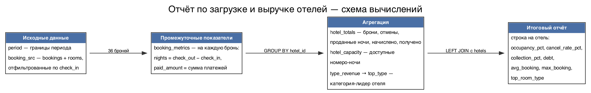

# ЛР 2. Разработка SQL-запросов и аналитических сценариев

**Вариант 8 — система бронирования гостиниц.** Запросы выполняются на модели из [ЛР 1](../lab1/).

## Задание

**Часть 1. Подготовка данных и операции DML**

1.1. Дополнить базу тестовыми записями: не менее 100 записей суммарно и не менее 30 в одной
из основных операционных таблиц, не менее трёх состояний основного бизнес-процесса, данные
минимум за три календарных месяца, повторяющиеся операции одной сущности, сущности без
связанных операций, пограничные значения.

1.2. Реализовать сценарий изменения данных: `INSERT` новой сущности со связанными записями,
`UPDATE` состояния операции, массовое изменение по содержательному условию, `DELETE` с учётом
ограничений целостности, демонстрация `ROLLBACK`.

**Часть 2. Операционная информация**

2.1. Три запроса с `JOIN`, каждый не менее чем по трём таблицам: подробная информация об
операциях, выявление объектов без связанных записей, перечень объектов по нескольким
взаимосвязанным условиям. Минимум один запрос — с `LEFT JOIN`.

2.2. Три аналитических запроса с агрегатными функциями и `GROUP BY`: количественные показатели
по группам, суммарные или средние показатели с фильтрацией групп через `HAVING`, сравнение
показателей между категориями или временными периодами. Не менее трёх функций из `COUNT`,
`SUM`, `AVG`, `MIN`, `MAX`.

**Часть 3. Подзапросы**

Четыре запроса: сравнение показателя со средним по группе, `EXISTS`, `NOT EXISTS`,
коррелированный подзапрос.

**Часть 4. Аналитический отчёт**

Один запрос с `CTE`, отвечающий на содержательный вопрос предметной области, со схемой
вычислений «исходные данные → промежуточные показатели → агрегация → итоговый отчёт».

## Файлы

| Файл | Содержание |
| --- | --- |
| [data.sql](data.sql) | задание 1.1 — набор данных: 126 записей, 36 бронирований |
| [dml.sql](dml.sql) | задание 1.2 — пять операций изменения данных |
| [queries_join.sql](queries_join.sql) | задание 2.1 — три многотабличных запроса |
| [queries_aggregate.sql](queries_aggregate.sql) | задание 2.2 — три запроса с агрегацией и `GROUP BY` |
| [queries_subquery.sql](queries_subquery.sql) | часть 3 — четыре запроса с подзапросами |
| [report_cte.sql](report_cte.sql) | часть 4 — отчёт по загрузке и выручке отелей |
| [report-pipeline.png](report-pipeline.png) | схема вычислений отчёта |
| `report-pipeline.dot` | исходник схемы: `dot -Tpng -Gdpi=140 файл.dot -o файл.png` |

## Схема вычислений отчёта



## Запуск

PostgreSQL 17 установлен локально, порт 5432. База и пользователь создаются один раз:

```bash
psql -h localhost -p 5432 -U postgres -c "CREATE USER student WITH PASSWORD 'student';" -c "CREATE DATABASE labs OWNER student;"
```

Дальше из корня репозитория (пароль пользователя `student` — `student`):

```bash
psql -h localhost -p 5432 -U student -d labs -f lab1/schema.sql
psql -h localhost -p 5432 -U student -d labs -f lab2/data.sql
psql -h localhost -p 5432 -U student -d labs -f lab2/queries_join.sql
psql -h localhost -p 5432 -U student -d labs -f lab2/queries_aggregate.sql
psql -h localhost -p 5432 -U student -d labs -f lab2/queries_subquery.sql
psql -h localhost -p 5432 -U student -d labs -f lab2/report_cte.sql
psql -h localhost -p 5432 -U student -d labs -f lab2/dml.sql
```

`data.sql` можно запускать повторно: он очищает таблицы и сбрасывает счётчики id.
`dml.sql` изменяет данные, поэтому запускается последним — чтобы повторить запросы,
достаточно снова выполнить `data.sql`.
